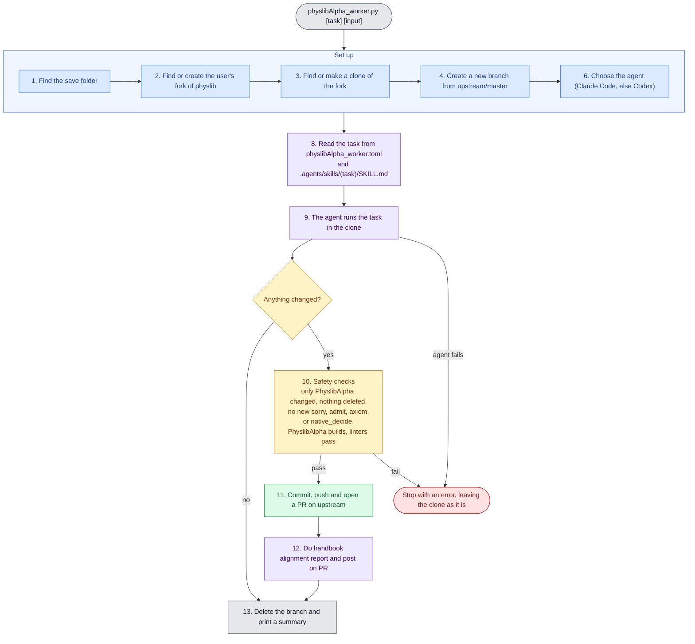

# physlibAlpha-worker

> This README contains a mermaid diagram, so should be viewed using a markdown viewer.

`physlibAlpha_worker.py` runs one task on PhyslibAlpha with an AI agent and opens a PR with the result. The numbers in the diagram are the sections of the script.

